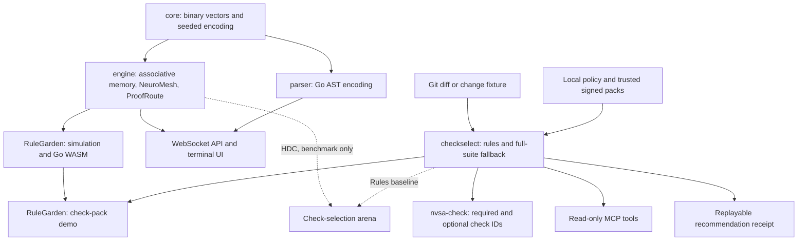

# NeuroVSA

**A deterministic, CPU-only Hyperdimensional Computing (HDC) toolkit in Go.** Build
inspectable decision systems for structured data using binary vectors, associative
memory, and replayable decisions. No model downloads or GPU required.

[](https://github.com/JGautam09/NeuroVSA/actions/workflows/ci.yml)
[](https://go.dev/)
[](LICENSE)

[Try check selection](#try-check-selection) · [Open RuleGarden](#open-rulegarden) ·
[Architecture](#architecture) · [Benchmarks](#benchmarks) · [Contribute](CONTRIBUTING.md)

| I want to… | Start here |
| --- | --- |
| Understand which CI checks a change calls for | [Try the report-only go-chi example](examples/check-selection/chi/README.md). Keep your existing CI jobs. |
| See what a learned decision used, and what changes when a lesson is removed | [Run RuleGarden](rulegarden/README.md), the browser-based artificial-life sandbox. |
| Use binary vectors, mergeable associative memory, or re-executable decisions from Go | Start in [`core/`](core/) and [`engine/`](engine/); see the [developer guide](docs/developer_guide.md). |
| Reproduce the routing or check-selection measurements | See the [routing arena](arena/README.md) and [test-selection report](arena/check-selection/RESULTS.md). |

## Try check selection

`nvsa-check` is an experimental, local CLI for adding **explainable check recommendations**
to an existing CI workflow. It reads a committed Git diff or a saved change fixture and
returns check IDs and the rules that matched. It does not run tests or decide whether a PR
can merge.

With Go 1.22 or later, from a checkout that contains `cmd/nvsa-check`:

```sh
go build -o ./nvsa-check ./cmd/nvsa-check

./nvsa-check recommend \
  -config arena/check-selection/chi-policy.json \
  -fixture examples/check-selection/chi/middleware-change.json
```

```text
Required: ci-matrix
Optional: middleware-unit
Rule middleware matched ["middleware/request_size_test.go"]
```

If a path is uncovered or Git history cannot be read, the CLI recommends the entire
configured catalog. Repository policy owns required checks. Locally approved, signed packs
can suggest extra optional checks; they cannot remove requirements or suppress fallback.

- [Adopt it in another repo](examples/check-selection/chi/README.md): pinned real Git diff,
  deliberate policy regression, and a report-only GitHub Actions example.
- [CLI reference, receipts, packs, and MCP](docs/check-selection-replay.md): replay a decision,
  restrict signing keys by repo and check ID, and call the evaluator from a local MCP client.

## Open RuleGarden

RuleGarden is a deterministic world with creatures you can **teach**, **inspect**,
**forget**, and merge across exported worlds. **NeuroMesh** merges lesson ledgers and
tombstones; **ProofRoute** records the chosen action and the evidence needed to re-execute it.

```sh
sh web/rulegarden/build.sh
python3 -m http.server 8090 --bind 127.0.0.1 -d web/rulegarden
```

Open [localhost:8090](http://localhost:8090). Place a creature and a predator, then
select the creature to inspect its decision. Open **Check recommendation demo** to see
a separate signed check pack update, conflict, or get revoked without changing the
required check. The [RuleGarden guide](rulegarden/README.md) covers both kinds of
receipts and the optional peer-to-peer features.

## Architecture



The VSA engine binds vectors with XOR, bundles them by majority vote, rotates them to encode
order, and compares them by Hamming distance. Each 10,000-bit vector uses 1,256 bytes of
packed storage. Live check recommendations use explicit rules.
Its HDC selector is an offline comparison, not part of live recommendations.

[Architecture reference](docs/architecture.md) · [Developer guide](docs/developer_guide.md) ·
[User manual](docs/user_manual.md) · [Signed RuleGarden pack registry](registry/README.md)

## Benchmarks

| Experiment | What the measurements show |
| --- | --- |
| [Check selection](arena/check-selection/RESULTS.md) | On 57 held-out labeled cases, explicit rules selected 143 check IDs vs. 288 for the full catalog and omitted no labeled required checks after fallback. HDC added no coverage and reached 83.3% optional precision, so it remains benchmark-only. |
| [Text routing](arena/ARENA_RESULTS_STANDARD.md) | On CLINC150 and Banking77, HDC routed faster in the reported setup but trailed TF-IDF, model2vec, and all-MiniLM on accuracy. It is a better fit for bounded, structured inputs than free-form language. |
| [Vector operations](BENCHMARKS.md) and [dimensionality](docs/DIMENSIONALITY.md) | Reproducible timings and capacity tradeoffs explain why the default remains 10,000 bits. |

## Honest limitations

- HDC matches structure, not semantic intent; use a semantic embedding model for
  open-vocabulary routing.
- Selecting fewer check IDs does **not** establish lower CI runtime or equal defect
  detection. The benchmark measures agreement with labeled cases.
- A check receipt replays a recommendation. It does not attest to Git provenance or
  prove a check ran.

## Build, test, and contribute

```sh
go test -race ./...
go vet ./...
go build ./...
```

For the optional terminal UI, see the [server and UI setup](docs/user_manual.md).
For patches, fork the repo and open a pull request; see [Contributing](CONTRIBUTING.md)
for the workflow and [Security](SECURITY.md) for private reporting. See the
[changelog](CHANGELOG.md) for released and unreleased changes. This is a research toolkit:
interfaces may change and the new check-selection features should start in report-only mode.

## License

[Apache License 2.0](LICENSE). Copyright 2026 Jitendra Gautam.
